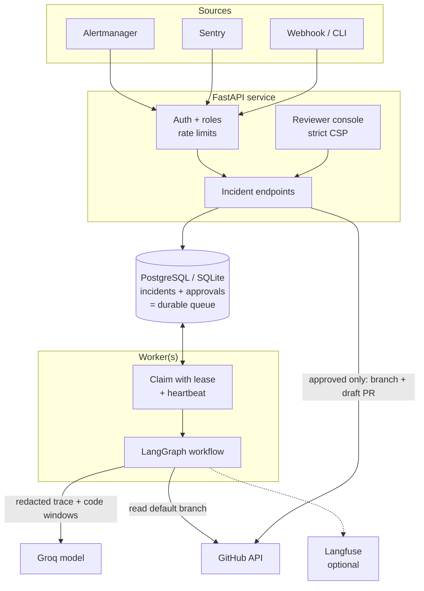
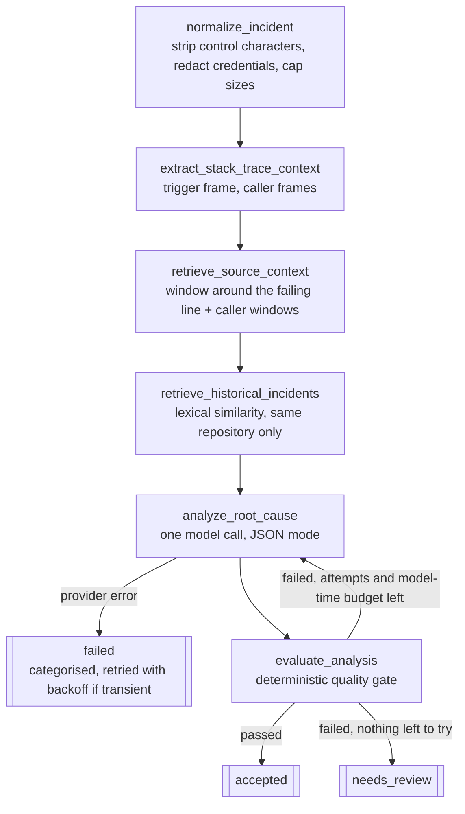
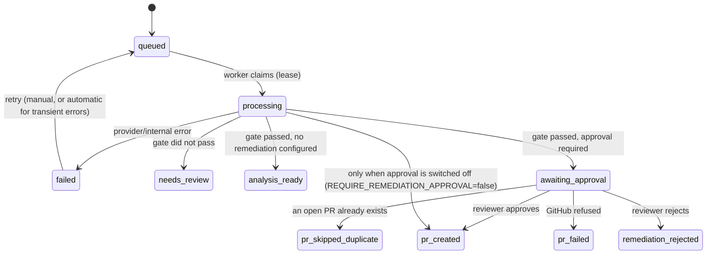

# Architecture

How an incident moves through OpsPulse AI, where each safety guarantee is enforced, and which test proves it. Everything
here describes the code as it is; where something is *not* done, [Limitations](LIMITATIONS.md) says so.

## 1. Components

- The **database is the queue**: an incident row is claimed with a compare-and-set that writes a lease and a claim token.
  Any number of workers can run; a worker that loses its claim discards its result.
- The **API never analyses**; it stores, serves and decides. With `EMBEDDED_WORKER=true` one worker thread runs inside the
  API process (convenient locally); production runs separate workers.
- **GitHub writes happen only in the approval path** (right-hand arrow). The analysis path only reads.

## 2. The analysis workflow

The loop is bounded three ways: `MAX_ANALYSIS_ITERATIONS` (default 3), `MAX_INCIDENT_SECONDS` (default 300 of model time;
no new attempt starts once spent) and the per-call timeout. It also stops early when another attempt cannot help: the model
says the evidence is insufficient, the analysis is grounded but needs no code change, or the source was not retrievable.

**The quality gate is code, not a model.** It scores 12 checks and passes only if the score reaches the threshold *and*
every blocking check is perfect: schema, trigger grounding, evidence grounding (each "observed" quote must occur verbatim
in its cited source), trace/code consistency, diff well-formedness, diff applicability to the retrieved file, and patch
effectiveness. Non-blocking checks (for example `fix_location`, which flags a patch to the failing function when the
evidence quotes only a caller) are shown to the reviewer instead. See ADR 0001.

## 3. What happens after the graph

Side effects live **outside** the graph (ADR 0002), because the analysis node may run several times.

The approval is a row bound to **one incident and the SHA-256 of the exact patch**. Deciding it needs the `reviewer` or
`admin` role, a matching hash, an unexpired row, and a reviewer other than the submitter. It is claimed with a
compare-and-set *before* the GitHub call, so a repeated or concurrent approve conflicts instead of opening a second PR.
An approval that has expired is refused (the incident must be re-submitted for a fresh proposal). The PR goes on a deterministic branch (`opspulse/fix-<fingerprint>`), is a **draft**, and there is no code path that
merges. If a step fails after the branch was created, the branch is removed again.

## 4. Where data goes

| Destination | What | Controls |
|---|---|---|
| Model (Groq) | error message, stack trace, code window (±50 lines), caller windows (±8), summaries of similar past incidents | credentials redacted first; untrusted text is wrapped in delimiters and cannot close them; the model has no tools |
| Langfuse (optional) | spans, versions, scores; long strings are replaced by a length marker | `LANGFUSE_CAPTURE_CONTENT=true` to opt in to content; telemetry failures never affect the analysis |
| GitHub | reads the default branch; **writes only after approval** | allow-listed repositories, protected paths refused, one file, size-limited diff, no credentials in the patch |
| Database | incident, analysis, the code windows the model saw (redacted, capped, never returned by the API), approvals | roles and per-identity rate limits on every endpoint |

## 5. Guarantee → mechanism → proof

| Guarantee | Enforced by | Proven by |
|---|---|---|
| An "observed" quote is really in the source | verbatim check in the gate | `test_graph`, `test_fuzz_model_output`, the evaluation reports |
| The gate never passes while a blocking check fails | gate logic | `test_fuzz_model_output` (4,000 random examples, plus two planted bugs it caught) |
| No GitHub write without a human decision | writes only in `remediation_service`; approval row; role check | `test_approval`, `test_agent_security` (scans the source tree for write calls outside the adapter), `test_e2e_flow` |
| An approval cannot be reused for a different patch | SHA-256 binding | `test_approval` (stale hash) |
| One approval, one PR, even under races | compare-and-set claim | `test_approval` (concurrent approvals), `test_queue` (4 threads, every incident claimed once) |
| A patch cannot add a credential or touch a protected path | remediation policy | `test_agent_security`, `test_github` |
| Credentials in a report do not reach the model, the PR text or logs | redaction at ingest, in PR text and in the log formatter | `test_agent_security`, `test_observability` |
| Telemetry cannot change the outcome | guarded spans | `test_telemetry_failures` |
| A model that returns anything still ends in a known state | bounded loop, total parsers | `test_fuzz_model_output`, `test_graph` |
| The assistant never recommends approving, in English or Turkish | answer guard | `test_fuzz_ask`, `test_ask` |
| The whole flow works end to end | everything above, wired | `python -m scripts.e2e_flow` (25 checks; unit test and CI step) |

Run any of it yourself: `python -m scripts.e2e_flow` for the flow, `pytest` for the rest.
